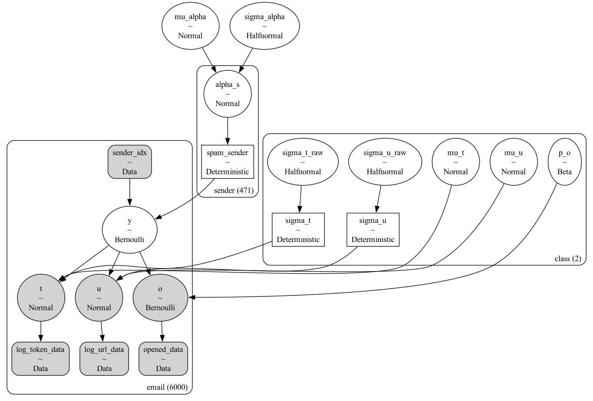
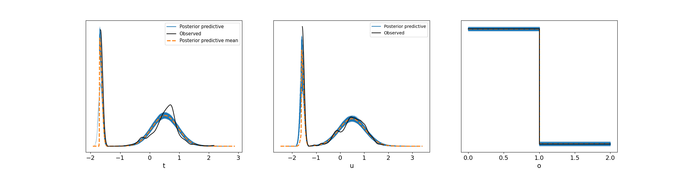

# Gmail Spam Classifier

An ISYE 6420 project using Bayesian hierarchical modelling to classify Gmail inbox data as
spam or ham, then act on the result — flagged messages are relabelled and removed from the
inbox.

## What it does

- Builds a spam-token library from Apache SpamAssassin's labelled public corpus
- Extracts email features from Gmail: sender, spam-token count, URL count, opened/not-opened
- Fits and compares two Naive Bayes mixture models:
  - **Sigmoid model** — partially pooled across senders
  - **Beta model** — no pooling
- Compares them with PSIS-LOO and posterior predictive checks
- Uses the better model, as chosen by LOO, to flag emails whose spam probability exceeds a
  threshold

## The model

Each sender gets their own spam propensity `alpha_s`, drawn from a shared
`Normal(mu_alpha, sigma_alpha)`. That is the partial pooling: a sender you have seen twice
borrows strength from the population, while a sender you have seen two hundred times is
allowed to speak for themselves. Given the latent class, the three features are conditionally
independent — log token count and log URL count as Normals, opened/not-opened as a Bernoulli.

*Sigmoid model at the largest run: 6,000 emails across 471 distinct senders.*

## Results

Posterior predictive checks for the same run — simulated draws against the observed
distribution for each feature:

Both models were fit at three dataset sizes — 50, 500 and 6,000 emails — so the effect of
pooling could be compared where sender data is sparse against where it is plentiful.
Posterior plots, PPCs and DAGs for every run are in [`Results/`](Results/).

Full write-up, including the LOO comparison and model selection: [`Report.pdf`](Report.pdf).

## Setup

You need your own Gmail API OAuth client. Place `client_secret.json` in the project root.

[How to generate one](https://www.youtube.com/watch?v=D8DMj2lQMwo)

> `client_secret.json`, `token*.json`, `.env` and everything under `data/` are gitignored and
> must never be committed. The token files carry refresh tokens that do not expire until they
> are revoked, and `data/` holds raw message content belonging to the people who wrote to you.

## How to run

1. `./scripts/fetch_data.sh` — downloads the Apache SpamAssassin public corpus into `data/raw`
2. `create_spamtoken_dataset.py` — processes and cleans the SpamAssassin spam data
3. `create_spamtoken_library.py` — extracts a library of spammy tokens from that dataset
4. `create_input_dataset.py` — extracts and cleans Gmail data for model processing
5. `spam_filter.py` — runs both Bayesian models, prints metrics, saves plots and DAGs, and
   determines spam
6. `main.py` — takes the spam emails from the chosen model, sends them to a spam label, and
   removes them from the inbox

## Data

The SpamAssassin corpus is third-party data and is not stored in this repository; step 1
fetches it. See the
[corpus readme](https://spamassassin.apache.org/old/publiccorpus/readme.html) for its
collection method and terms.
